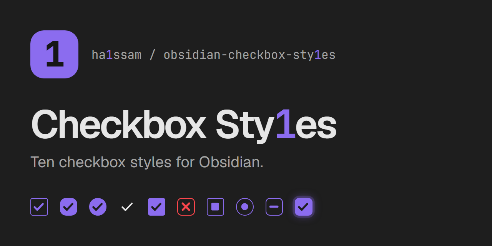

# Checkbox Sty1es

Pick a visual style for each task checkbox in Obsidian. Clicking an unchecked task opens a menu with 29 styles: ten checkbox shapes and 19 colored icons. Each style changes how the checkbox looks and can apply a matching effect to the task text.

Turn on extra sections (priority, status, seasons, flags and more) or add your own images, such as team crests. Each one shows up as a tab in the menu.

## Checkbox shapes

| Style | Text effect | Written to the note |
|---|---|---|
| Classic | strikethrough | `- [c]` |
| Rounded | muted | `- [r]` |
| Circle | accent color | `- [o]` |
| Minimal | faint | `- [m]` |
| Filled | bold | `- [f]` |
| Cross | red strikethrough (cancelled) | `- [-]` |
| Square | underline | `- [s]` |
| Dot | italic (in progress) | `- [.]` |
| Dash | dashed underline (postponed) | `- [~]` |
| Glow | glowing text | `- [g]` |

## Icons

Icon styles replace the checkbox with a colored icon. Most leave the text as it is.

| Style | Text effect | Written to the note |
|---|---|---|
| In progress | none | `- [/]` |
| Forwarded | muted | `- [>]` |
| Scheduled | muted | `- [<]` |
| Question | none | `- [?]` |
| Important | bold | `- [!]` |
| Star | none | `- [*]` |
| Quote | italic | `- ["]` |
| Location | none | `- [l]` |
| Bookmark | none | `- [b]` |
| Info | none | `- [i]` |
| Savings | none | `- [S]` |
| Idea | none | `- [I]` |
| Pro | none | `- [p]` |
| Con | none | `- [C]` |
| Fire | none | `- [F]` |
| Key | none | `- [k]` |
| Win | none | `- [w]` |
| Up | none | `- [u]` |
| Down | none | `- [d]` |

## Extra sections

The 29 styles above are always in the menu. Extra sections are off by default; turn on the ones you want in the settings and they show up as tabs in the menu, with a search box that looks through all of them.

| Section | Styles |
|---|---|
| Priority | Urgent, High, Medium, Low, Lowest |
| Status | Backlog, Waiting, Blocked, Paused, In review, Delegated, Approved, Rejected |
| Work | Meeting, E-mail, Call, Bug, Code, Document, Deadline, Launch |
| Colors | The classic checkbox in red, orange, yellow, green, cyan, blue, purple, pink and gray, with text in the same color |
| Mood | Happy, Neutral, Sad, Angry, Tired, Love |
| Health | Workout, Cardio, Water, Medicine, Sleep, Healthy food |
| Study | Reading, Class, Exam, Homework, Research, Review |
| Money | Bill, Card, Income, Expense, Invest |
| Home | Groceries, Cleaning, Repair, Delivery, Gift, Plants, Pet |
| Travel | Flight, Hotel, Luggage, Ticket, Map, Car, Vacation |
| Seasons | New Year, Valentine's Day, Carnival, Easter, Festa Junina, Halloween, Christmas, Spring, Summer, Autumn, Winter |
| Flags | 32 national flags from the Americas, Europe, Africa, Asia and Oceania |

Turning a section off only hides it from the menu. Tasks that already use its styles keep their look.

## Your own images

Point the **Images folder** setting at a folder in your vault and its images (PNG, JPG, SVG, WebP, GIF, AVIF) become styles. Images directly in the folder form one section, named after the folder; each subfolder becomes its own section. For example:

```
Checkbox styles/
├── Football/
│   ├── Flamengo.png
│   └── Palmeiras.png
└── Games/
    └── Zelda.svg
```

This gives you a **Football** tab and a **Games** tab. File names become style names (dashes and underscores turn into spaces). New, renamed and deleted images are picked up right away. You are responsible for the rights to the images you add.

## How it works

- The chosen style is stored as the character between the brackets, so tasks stay plain Markdown tasks. Nothing else in the note is changed.
- Extra sections and your own images use characters from Unicode's Private Use Area (U+E000–U+F8FF), which is reserved for app-specific symbols, so they never clash with letters or with characters used by themes and other plugins. Each style's character is fixed: it does not change between versions, and renaming or moving one of your images keeps its character. Outside Obsidian (or with the plugin off) these characters show up as a placeholder box.
- One mouse button opens the style menu and the other checks and unchecks the task. You choose which is which in the settings.
- On a phone or tablet, the same choice is between tap and tap-and-hold.
- Checking a task with the other button writes a plain `[x]`, shown in the default style chosen in the settings. Unchecked tasks use that style too.
- Colors come from the current theme's variables, so the styles follow light and dark themes.

## Uncheck all tasks

The uncheck-all action unchecks every task in the open note. Use it again right away and the tasks go back to how they were; once you change anything in the note, the saved state is dropped so nothing you edited is overwritten. It is off by default: in the settings you can turn on a button for it at the top of each note, record a keyboard shortcut for it, or both.

## Settings

- **Menu button** — on a computer, left click or right click opens the style menu; the other button checks and unchecks the task.
- **Menu on mobile** — on a phone or tablet, tap or tap-and-hold opens the style menu; the other gesture checks and unchecks the task.
- **Uncheck-all button** — show the uncheck-all button at the top of each note.
- **Uncheck-all hotkey** — record a keyboard shortcut for unchecking all tasks in the current note.
- **Default style** — the style applied when you check a task with the other button, and the look of unchecked and `[x]` tasks.
- **Menu sections** — turn each extra section on or off.
- **Images folder** — the folder with your own images; each of its sections can also be turned off.

## Limitations

- Plugins that only treat `[x]` as done (for example Tasks or Dataview queries) may not count styled tasks as completed.
- Themes that ship their own alternate checkbox icons may override some styles.
- Checkboxes inside embeds, canvas cards and callouts keep the native click behavior.

## Development

```bash
npm install
npm run build
```

`styles.css` is generated from `src/styles.base.css` and the sections registered in `src/sections.ts`. Basic styles live in `src/checkbox-styles.ts`; extra sections live in `src/packs/`.

To add a style to a section, add an entry with the next free `at` position. Each section owns a fixed block of 256 characters (`block`), and a published position must never be changed or reused. To add a section, give it an unused block (0–15) and add it to `PACKS`. The build fails if two styles share an id or a character.
